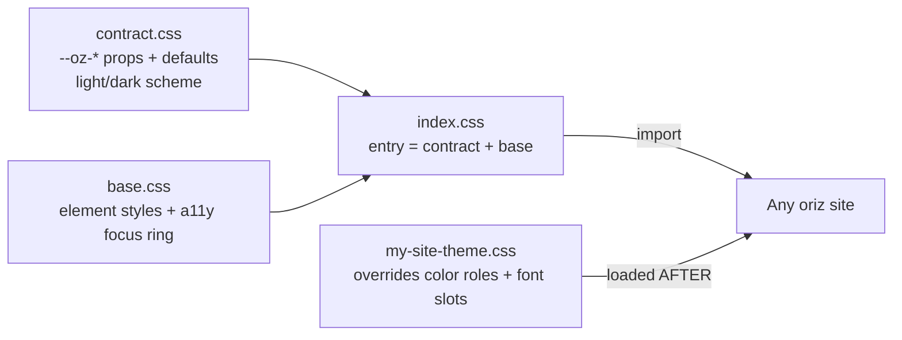

# @chirag127/oz-tokens-base

> The `--oz-*` CSS custom-property contract — a shared design-token base that every oriz site imports, then overrides with its own palette and type. Pure CSS, no JS, zero runtime deps.

[](LICENSE)
[](https://github.com/chirag127/oz-tokens-base/stargazers)
[](https://github.com/chirag127/oz-tokens-base/commits/main)
[](https://www.npmjs.com/package/@chirag127/oz-tokens-base)

## What it is / why it exists

Across ~80 oriz sites, every UI needs the same *vocabulary* — a background role, a foreground role, an accent, a space scale, radii, motion durations. Redefining that vocabulary per site drifts fast. `oz-tokens-base` is the single **contract**: it declares every `--oz-*` custom property with sane, accessible defaults (including a light/dark scheme and a focus ring). Each site imports it for the shared mechanism, then **overrides** the color roles and font slots to carry its own bespoke look. Shared contract, unique look.

## Links

- **npm:** https://www.npmjs.com/package/@chirag127/oz-tokens-base
- **Landing page (GitHub Pages):** https://chirag127.github.io/oz-tokens-base/ (redirects to npm)
- **Repo:** https://github.com/chirag127/oz-tokens-base

⭐ **If this is useful, please star the repo — it helps others find it.**

## How it composes



## Features

- **One contract, many looks** — sites share the `--oz-*` mechanism, override only colors + fonts.
- **Light + dark out of the box** — `color-scheme: light dark` with sensible defaults for both.
- **Accessible by default** — ships a visible focus ring in `base.css`.
- **Framework-agnostic** — pure CSS custom properties; works with any stack, no build step, no JS.
- **Granular exports** — pull the full entry, contract-only, or base-only.

## Tech stack

Pure CSS custom properties. No dependencies, no runtime, no build. Distributed as an ES-module-typed npm package (`"type": "module"`, CSS entry).

## Repository structure

```
src/
├── index.css      entry — @imports contract.css + base.css
├── contract.css   the --oz-* contract + neutral defaults + light/dark scheme
└── base.css       base element styles + a11y focus ring
package.json        exports map (entry / contract.css / base.css)
```

## Install

```sh
npm i @chirag127/oz-tokens-base
```

## Usage

Import the contract, then load your own overrides **after** it:

```html
<link rel="stylesheet" href="@chirag127/oz-tokens-base" />
<link rel="stylesheet" href="/my-site-theme.css" />
```

Or in CSS:

```css
@import "@chirag127/oz-tokens-base";
```

Give the site its own look by overriding the color roles + font slots:

```css
/* my-site-theme.css — loaded after the import */
:root {
  --oz-bg: #fffaf3;
  --oz-fg: #241b12;
  --oz-accent: #d6552b;
  --oz-accent-fg: #fffaf3;
  --oz-font-display: "Fraunces", serif;
  --oz-font-body: "Inter", sans-serif;
}
```

## Reference

### Override these (per-site color roles + fonts)

| Prop | Role |
| --- | --- |
| `--oz-bg` | page background |
| `--oz-fg` | primary text |
| `--oz-surface` | raised panel / card |
| `--oz-muted` | secondary text / icons |
| `--oz-border` | hairlines, dividers, input borders |
| `--oz-accent` | brand / interactive |
| `--oz-accent-fg` | text on `--oz-accent` |
| `--oz-font-display` / `--oz-font-body` / `--oz-font-mono` | font-family slots |

### Do NOT override (shared primitives — keep rhythm consistent)

`--oz-space-{1,2,3,4,6,8,12,16}` · `--oz-radius-{s,m,l,full}` · `--oz-dur-{fast,base,slow}` · `--oz-ease-{out,in-out}`

### Exports

| Specifier | File |
| --- | --- |
| `@chirag127/oz-tokens-base` | contract + base (entry) |
| `@chirag127/oz-tokens-base/contract.css` | contract + defaults only |
| `@chirag127/oz-tokens-base/base.css` | base element styles + focus ring only |

## Part of the oriz family

Part of the [oriz](https://blog.oriz.in) family — a fleet of ~80 small, focused apps and sites. This package is the shared token base those sites build on.

## Contributing

Issues and PRs welcome. Keep it pure CSS — no JS, no dependencies. Conventional-commit messages, please.

## License

[MIT](LICENSE) © 2026 Chirag Singhal

## Author

Chirag Singhal — [chirag@oriz.in](mailto:chirag@oriz.in)

## Status

Early but usable (v0.1.0). API surface (the `--oz-*` contract) is intentionally small and stable. Conventional commits are the changelog.
